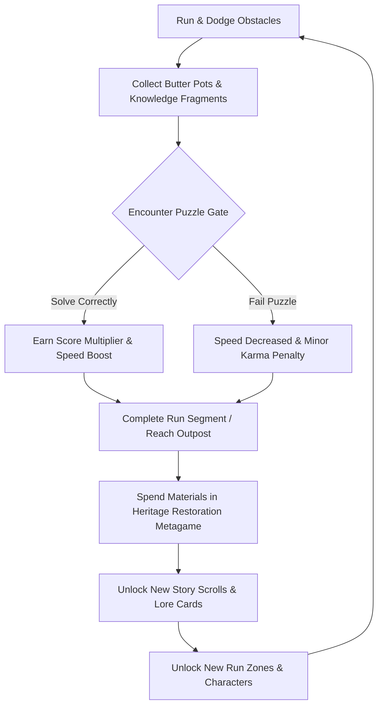

# Game Design Document (GDD): *Leela: Chronicles of Bharat*

## 1. Core Gameplay Loop
The core loop integrates dynamic movement, cognitive challenges, educational milestones, and progression-based meta-gameplay.

1. **Run:** The player runs through high-fidelity, culturally authentic landscapes, gathering "Makhan Pots" (progression points) and "Gyan Patras" (Knowledge Fragments).
2. **Explore & Solve:** Runs are periodically interrupted or branched by **Puzzle Gates** (e.g., Flute Melodies, Sudarshan Gates).
3. **Learn & Unlock:** Solving puzzles and collecting fragments unlocks beautifully illustrated Story Scrolls in the player's Sanctuary.
4. **Restore:** Players use collected resources to rebuild historical monuments, which in turn unlocks new running trails, visual upgrades, and avatar abilities.

---

## 2. Controls and Traversal Mechanics
Unlike traditional runners that only allow left/right, jump, and slide, *Leela* introduces organic, fluid verticality:
* **Lane Swiping (Standard):** Swipe Left/Right (or use Arrow keys on desktop) to change lanes.
* **Jumping & Sliding (Standard):** Swipe Up (or Up Arrow) to jump, Swipe Down (or Down Arrow) to slide.
* **Wall Running:** In narrow temple corridors, swiping/pressing towards a decorated wall initiates a wall-run, allowing players to bypass floor hazards.
* **Feather Glider (Pushpak Mode):** Collecting a peacock feather allows Krishna to glide over deep river ghats or forest chasms. Double-tap/Press to float.
* **Swing Traversal:** Using hanging vines or temple ropes. Players tap/hold when passing a swing point to leap across massive gaps, swinging in a pendulum arc.

---

## 3. The 10 Unique Differentiators

Designed specifically for the educational event:

### 1. Heritage Restoration System
Players spend gathered resources to rebuild ruins (e.g., the Kesi Ghat in Vrindavan or the Dwarakadheesh Temple gates). Rebuilding a site increases the player's global level, unlocks new running areas, and populates the locations with pilgrims and historical figures.

### 2. Living Story World
As a zone is restored, its visual appearance in the runner changes permanently. Ruined, overgrown pathways transform into clean stone ghats, lit by oil lamps, with blooming lotuses and active cultural festivals.

### 3. Knowledge Power-Ups
During runs, players encounter glowing blue portals. Passing through triggers a rapid-fire multiple-choice question on Bharat's heritage. Correctly answering within 3 seconds triggers a "divine aura" (magnet shield, invincibility, or double score points) corresponding to the correct answer.

### 4. Time Travel Portals
Running through a golden "Kaal Chakra" (Time Portal) seamlessly warps the player between eras. For example, running through modern-day Mathura shifts into ancient, mythological Mathura with mythological obstacles, shifting the gameplay layout instantly.

### 5. Yuga Cycle Day/Night Loop
The game syncs with a fast-forwarded in-game clock. At night, levels are lit by lanterns, and different obstacles appear (e.g., sleeping forest creatures or night guards), requiring players to adapt their traversal.

### 6. Sacred Cowherd Companion (Sakhas)
Players can equip a companion (like Balarama, Sudama, or a sacred calf). Companions fly or run alongside the player, automatically collecting hard-to-reach collectibles or providing a one-time "save" when hitting an obstacle.

### 7. Rasa Leela Rhythm Run
Special sections of the level transform the screen into a rhythm runner. The lane lines glow as musical strings, and players must lane-shift in rhythm to classical sitar and flute beats, yielding massive score multipliers.

### 8. Karma Meter Path Splits
Throughout the run, lanes branch into ethical choices. For example: Lane A requires taking a shortcut by trampling sacred flowers, while Lane B is longer and harder but involves rescuing a trapped deer. Choosing Lane B rewards "Karma Points" which boost luck (higher spawn rate of power-ups).

### 9. Divine Manifestations (Leela Avatars)
Players can unlock and play as different manifestations of Krishna, each with a distinct gameplay passive:
* *Makhan Chor (Child Krishna):* High slide speed, smaller hitbox, double butter collection.
* *Giridhari (Govardhan Krishna):* High shield duration, breaks physical barriers.
* *Dwarkadhish (King Krishna):* Collects gold coins at a distance, high score multiplier.
* *Parthasarthy (Charioteer Krishna):* Faster reaction speed, immune to speed slows.

### 10. Govardhan Lift Challenge (Interactive Boss Run)
At the end of the Govardhan forest run, the demon Indra sends a massive thunderstorm. The run transitions into a survival challenge where the player must dodge falling lightning bolts and boulders while holding the screen center to balance and "lift" the Govardhan hill.

---

## 4. Puzzle System Integration
Puzzles occur at specific milestones during a run (every 1000 meters) or at designated "Heritage Gates" in level mode.

| Puzzle Category | Description | Mechanics |
| :--- | :--- | :--- |
| **Sudarshan Gates** | High-speed lane puzzles. | Three gates appear ahead. Each gate has a Sanskrit character or mathematical pattern. The player must lane-switch to the gate matching the correct prompt shown at the top of the screen. |
| **Flute Melody Puzzle** | Auditory memory challenge. | The runner slows down to a crawl. A flute plays a simple 3-note sequence. A grid of 3 symbols appears. The player taps the symbols in the correct order to cast a barrier-shattering spell. |
| **Temple Symbol Matching** | Visual matching puzzle. | As the runner enters a temple, wall carvings appear on the left and right. The player must swipe/press to match corresponding symbols (e.g., Lotus to Lotus, Conch to Conch) before reaching the altar. |
| **Govardhan Path Puzzle** | Navigational puzzle. | The pathway splits into four lanes. The player is shown a quick aerial map of the forest. Only one path is clear; the others are blocked. The player must choose the correct lane based on the map memory. |
| **Mythology Logic Challenges** | Contextual logic mini-games. | Quick swipe puzzles (e.g., arrange stepping stones in the Yamuna river to help Krishna cross without disturbing the serpent Kaliya). |

---

## 5. UI/UX Flow Description
* **Sanctuary (Main Menu):** A tranquil, interactive 3D temple garden. Tap on monuments to enter the restoration panel, tap on the shrine to view unlocked Story Scrolls, or tap "Leela Run" to enter matchmaking/levels.
* **In-Run UI:** Minimalist and clean. Score and Butter Pots are displayed at the top right. The Karma Meter is on the top left. Knowledge indicators appear only when entering puzzle zones.
* **End-of-Run UI:** Displays run statistics (distance, coins, puzzles solved, karma gained) in a scroll-like interface, highlighting the story scrolls unlocked during the run.
