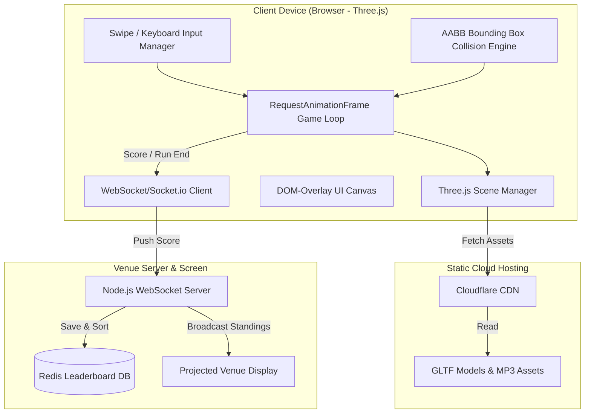

# Technical Architecture: *Leela: Chronicles of Bharat*

This document outlines the technical framework and system design for the non-commercial event edition of the game, highlighting the **Three.js WebGL-first** deployment pipeline to enable zero-friction, browser-based QR-code-scannable gameplay.

---

## 1. Platform Comparison & Target Recommendation

To achieve maximum accessibility and eliminate friction at live venues, we prioritize browser-based instant gameplay over native downloads.

| Feature / Criteria | Mobile Web (Three.js WebGL) | Native Mobile App (Unity) | PC Kiosk Installation |
| :--- | :--- | :--- | :--- |
| **Reach & Friction** | **Maximum.** Instant play via scanning a QR code. | Low. Requires app store download. | Limited to physical machines. |
| **Download Footprint** | **< 15 MB** (Optimized models & textures). | ~150 MB (Engine runtime overhead). | Unconstrained. |
| **First Load Time** | **< 3 seconds** on standard cellular data. | ~1–2 minutes (Install + launch). | Instant. |
| **Graphics Library** | WebGL 2.0 via Three.js. | OpenGL ES 3.0 / Metal. | DirectX 12 / Vulkan. |
| **Input Systems** | Touchscreen Swipes, Keyboard (WASD). | Touchscreen Gestures, Gyro. | Keyboard, Gamepad, Arcade Sticks. |
| **Monetization** | None. | None. | None. |

### Recommendation: Three.js WebGL Client for QR-Code Play
* **Primary Deployment:** Mobile-friendly WebGL application written in TypeScript using the **Three.js** library, hosted on lightweight static web hosting. 
* **Secondary Deployment:** Physical PC Kiosk stations at the event venue running the WebGL client in full-screen browser mode, equipped with tactile arcade controllers or keyboards.

---

## 2. Technology Stack Selection

### A. Game Engine/Library: Three.js (WebGL / TypeScript)
* **Why not Unity WebGL?** Unity's WebGL export includes the entire C++ WebAssembly engine runtime (~15–30MB zipped), resulting in long load times on mobile browsers (often crashing due to mobile memory constraints).
* **Why Three.js?** Three.js is a lightweight JavaScript library. The final compiled game bundle (logic + engine) is under 1.5MB. Assets are loaded on-demand, yielding near-instant load times on mobile devices.
* **Scripting Language:** TypeScript for structured, type-safe development of game states, movement vectors, and collision models.

### B. Event Backend: Node.js with Socket.io
* **Purpose:** Syncing player high scores with a live, projected Leaderboard display at the venue.
* **Matchmaker:** Lightweight WebSocket connections. No matchmaking lobby is required for multiplayer; instead, the socket connection simply streams real-time score feeds to the central event screen.

### C. Database & Hosting
* **Database:** Redis (in-memory database) for fast, real-time leaderboard sorting during the event window.
* **Hosting:** Static hosting via GitHub Pages, Netlify, or AWS S3 + CloudFront CDN for the client files. Node.js backend hosted on a small AWS EC2 instance or local server at the venue.

---

## 3. WebGL Client Architecture (Three.js)

The client codebase is structured as a modular object-oriented TypeScript application:

### Core Web Engine Components:
1. **Renderer Module:** Initializes the Three.js WebGLRenderer, PerspectiveCamera, and dynamic lighting.
2. **Track Generator:** Procedurally generates obstacles by placing pre-loaded 3D meshes (GLTF format) at varying distances along the Z-axis.
3. **Locomotion System:** Handles lane shifts (interpolating the X position of the player mesh) and jump/slide physics (modifying the Y position and scale).
4. **Collision Engine:** Utilizes Axis-Aligned Bounding Boxes (AABB) to detect intersections between the player's bounding box and obstacles, minimizing CPU overhead.
5. **Asset Loader (GLTF/GLB):** Drastically compresses 3D models using Draco compression, loading environment files asynchronously.

---

## 4. Performance & Memory Optimization

* **Draco Mesh Compression:** Compresses GLTF models up to 90%, reducing a 5MB temple model to less than 500KB.
* **Low-Draw Call Materials:** Standardize on unlit textures or lightweight standard materials using basic directional lighting to prevent mobile GPUs from bottlenecking.
* **Z-Buffer Occlusion:** Programmatically remove (dispose of) tracks and obstacles that have passed behind the camera plane to free WebGL memory.
* **DOM UI Overlay:** Render UI text, menus, and story pages using clean HTML5/CSS3 layered on top of the WebGL canvas, saving WebGL rendering cycles.
