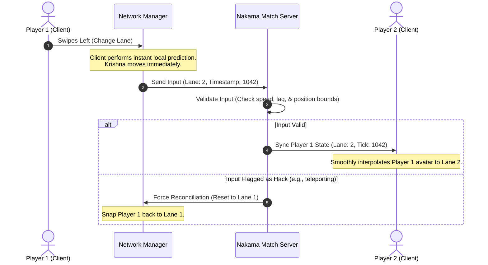

# Multiplayer Architecture: *Leela: Chronicles of Bharat*

*Leela: Chronicles of Bharat* features competitive real-time races, asynchronous ghost challenges, and massive collaborative community events. This document details the network topology, synchronization flow, tech comparisons, and anti-cheat design.

---

## 1. Multiplayer Game Modes

### A. Real-Time Heritage Races (4-Player Lobbies)
* **Description:** Four players race through a dynamically synchronized runner track. The player who finishes first or survives the longest wins.
* **Mechanics:** Players run in parallel lanes or overlapping lanes. To avoid chaotic physics collisions, players are rendered as semi-transparent "ghosts" in adjacent lanes, but they share the exact same obstacle spawns, puzzle gates, and power-up locations.
* **Interactivity:** Players can use "Leela Powers" to hinder opponents (e.g., throwing a color splash on their screen during Holi events or summoning a flock of peacocks to clutter their vision).

### B. Asynchronous Ghost Run
* **Description:** Players challenge the best run of their friends or top leaderboard players.
* **Mechanics:** The client downloads a compressed packet containing the positional and animation state history (the "ghost data") of the target runner and replays it alongside the live player. No real-time server connections are required after the initial download, saving server bandwidth.

### C. Cooperative Restoration Events (Massively Multiplayer Meta)
* **Description:** Community-wide global goals (e.g., "Rebuild the main archway of Dwarka before Janmashtami").
* **Mechanics:** Every butter pot and stone collected by any player globally contributes to a shared counter. Reaching milestones unlocks limited-edition cosmetic avatars and special festival zones for all participants.

---

## 2. Technology Comparison & Selection

To power these multiplayer modes, we evaluate five popular netplay frameworks:

| Metric / Feature | Unity Netcode (NGO) | Photon Fusion | Mirror | PlayFab Matchmaking | Nakama (Heroic Labs) |
| :--- | :--- | :--- | :--- | :--- | :--- |
| **Topology** | Server-Authoritative / Host | Client-Side Prediction / Dedicated Server | Client-Authoritative / Dedicated Server | Matchmaking lobby only; requires server | Server-Authoritative (Go/TypeScript Lua modules) |
| **Hosting Cost** | High (Requires dedicated servers for physics). | High (CCU-based licensing model). | High (Dedicated virtual machines). | Moderate (Azure VM scaling). | **Low** (Self-hosted on AWS ECS/Kubernetes). |
| **Latency** | Low (UDP / KCP). | Extremely Low (State Transfer/Delta). | Moderate. | High (HTTP-based lobby polling). | Low (WebSockets for lobbies/races). |
| **Integration Ease** | Medium (Official Unity integration). | Medium (Requires proprietary SDK). | High (Simple, classic API). | High (Standard Web API). | High (Robust Unity client SDK). |

### Recommendation: Nakama Server + Unity Client-Side Prediction
* **Why Nakama?** Nakama provides the lobby management, matchmaker, and storage out-of-the-box. It allows developers to write custom match rules in TypeScript or Go. This code runs authoritatively on the server, preventing players from hacking scores.
* **Network Topology:** **Server-Authoritative WebSockets**. Because *Leela* is a runner game, movements are highly predictable (moving between 3 lanes, jumping, sliding). We do not require high-frequency physics engines (like Unreal's replication). A lightweight server ticking at 15Hz is sufficient to sync player positions and validate puzzle inputs.

---

## 3. Client-Server Synchronization Flow

The diagram below details how the client synchronizes positioning, obstacle collisions, and puzzle completions with the server.

### A. Lag Compensation & Reconciliation
* **Client-Side Prediction:** When the player swipes to change lanes, the avatar moves instantly on the client's screen. The client sends a packet containing the lane transition, speed, and timestamp.
* **Server Verification:** The server tracks player speed and distance traveled. If a client packet reports a position that exceeds the maximum possible speed, the server flags it and sends a reconciliation packet, forcing the client to snap back to the server's validated position.

### B. Bandwidth Optimization
To reduce cellular data usage on mobile networks:
* **Delta Compression:** The client only sends packets when the player changes state (e.g., lane change, jumping, sliding, colliding). If running straight, the client only sends low-frequency keep-alive ticks (1 per second).
* **Protocol Buffers (Protobuf):** Data is serialized into compact binary formats rather than JSON strings, reducing packet sizes by up to 75%.

---

## 4. Anti-Cheat Architecture
To ensure high-score integrity and fair rewards:
1. **Server-Authoritative Score Accumulation:** Coins and score points are not tracked by the client memory. The server knows the layout of the obstacles and calculates the running score based on time survived and validated power-ups collected.
2. **Encrypted Local Storage:** Local save files containing unlocked stories and offline currency are encrypted using **AES-256** with a device-unique hardware key (Android ID / iOS Vendor ID).
3. **Memory Scrambling:** In-game variables (like speed and invincibility status) are masked using random offsets in memory to prevent runtime manipulation tools (like Cheat Engine or GameGuardian) from modifying variables.
