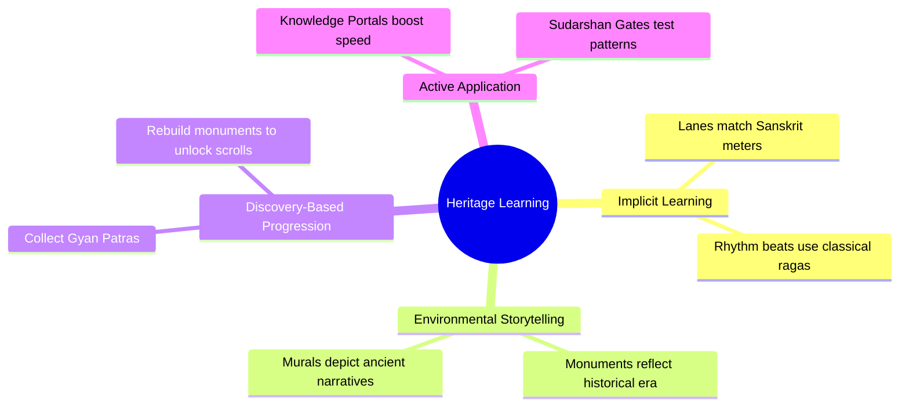

# Educational Framework: *Leela: Chronicles of Bharat*

The key differentiator of *Leela: Chronicles of Bharat* is its educational depth. The framework avoids dry quizzes or forced text walls. Instead, it relies on **Implicit Learning, Environmental Storytelling, and Discovery-Based Engagement**.

---

## 1. Core Educational Pillars

### A. Implicit Learning (Gameplay Mechanics as Knowledge)
* **What it is:** The mechanics themselves reflect the subject matter.
* **Implementation:** Standard runner tracks are mapped to traditional Sanskrit meters (rhythm of runs corresponds to *Anustubh* or *Tristubh* poetic meters). Soundtracks introduce classical Indian ragas associated with different times of the day (e.g., *Raga Bhairav* for sunrise runs, *Raga Yaman* for evening runs).

### B. Environmental Storytelling (Visual and Contextual Clues)
* **What it is:** The background details and obstacles teach the player without a single word of text.
* **Implementation:** In the Kurukshetra level, the background features the distinct battle formations (*Vyuhas*) described in the Mahabharata. In Dwarka, submerged pillars and marine flora show the historical marine archaeology of the site, making players naturally curious about why a city is under the ocean.

### C. Discovery-Based Progression (The Story Sanctuary)
* **What it is:** Player actions earn lore, which is framed as unlocking "lost memories."
* **Implementation:** Collecting "Gyan Patras" (Knowledge Fragments) does not instantly trigger popups. Instead, it aggregates into the player's library (Sanctuary) as pieces of a beautiful, hand-painted digital mural. Once all pieces of a mural (e.g., *Kaliya Daman*) are collected, the story comes alive with voice acting in the player's chosen language.

---

## 2. Heritage Syllabus and Content Mapping

The curriculum is distributed organically across nine major zones, each corresponding to a milestone in Krishna's life and Bharat's historical topography.

### 1. Mathura: The Foundation
* **Historical Significance:** Ancient trading capital, birthplace of Krishna.
* **Krishna Connection:** Birth in Kansa's high-security prison, crossing the stormy Yamuna.
* **Visual Landmarks:** Ornate stone prison cells, heavy iron chains, high watchtowers, red sandstone gates.
* **Implicit Learning Points:** The tyranny of King Kansa, the story of Devaki and Vasudeva.
* **Gameplay Opportunity:** A high-speed escape run starting from the prison vaults, passing through swinging pendulum blades and collapsing cell doors.

### 2. Gokul: Pastoral Childhood
* **Historical Significance:** Rural settlement along the banks of the Yamuna.
* **Krishna Connection:** Foster home raised by Yashoda and Nanda, childhood butter stealing antics.
* **Visual Landmarks:** Mud huts, thatch-roofed cattle sheds, clay butter pots (*Handis*), grazing fields.
* **Implicit Learning Points:** The simplicity of rural life, Krishna's nicknames (Gopala, Makhan Chor).
* **Gameplay Opportunity:** Steering through lanes crowded with sleeping calves and swinging milk pots, utilizing slide-attacks to swipe butter from high shelves.

### 3. Vrindavan: Sacred Forests
* **Historical Significance:** Holy town famous for its dense forests and pilgrimage sites.
* **Krishna Connection:** Playful childhood, encounters with demons sent by Kansa.
* **Visual Landmarks:** Lush forests (Nidhivan), Kadamba trees, river ghats (Kesi Ghat), blooming lotuses.
* **Implicit Learning Points:** Interdependence of nature and communities, key legends (e.g., taming the serpent Kaliya).
* **Gameplay Opportunity:** Swing traversal across the Yamuna river using Kadamba branches, dodging Kaliya's venomous geysers.

### 4. Govardhan: The Shield
* **Historical Significance:** Sacred hill in Mathura district.
* **Krishna Connection:** Lifting the Govardhan Hill to protect Gokul residents from Indra's torrential rains.
* **Visual Landmarks:** The rocky terrain of the hill, small shrines, falling waterfalls, storm clouds.
* **Implicit Learning Points:** The lesson of environmental protection (prioritizing nature over ritualistic worship of storm gods).
* **Gameplay Opportunity:** Running up steep rocky trails with high winds, avoiding falling boulders, culminating in the "Govardhan Lift" balance mini-game.

### 5. Barsana: The Hills of Devotion
* **Historical Significance:** Birthplace of Radha, located on a hill slope.
* **Krishna Connection:** Center of Radha-Krishna legends, the origin of Lathmar Holi.
* **Visual Landmarks:** Grand hilltop temples (Radha Rani Temple), stone step-paths, yellow-saffron sand, Holi color pots.
* **Implicit Learning Points:** The cultural celebration of spring, the poetry of devotion.
* **Gameplay Opportunity:** Running up steep stone stairs while dodging color cannons, using dynamic slide-turns on narrow ledge pathways.

### 6. Kurukshetra: The Path of Dharma
* **Historical Significance:** Historical battlefield in modern Haryana.
* **Krishna Connection:** Narrative setting of the Bhagavad Gita; Krishna acts as Arjuna's charioteer.
* **Visual Landmarks:** Chariot wheels, massive bronze war horns, flags, military tents, iron spears.
* **Implicit Learning Points:** The central themes of the Bhagavad Gita: duty, righteousness (Dharma), and selfless action (Karma).
* **Gameplay Opportunity:** Driving a chariot (Parthasarthy mode) through dynamic formations of soldiers and barricades, with short pause gates where players select Gita verses to clear obstacles.

### 7. Dwarka: The Golden Kingdom
* **Historical Significance:** Ancient coastal city in Gujarat, verified by marine archaeology.
* **Krishna Connection:** Capital city established by Krishna, which eventually submerged into the Arabian Sea.
* **Visual Landmarks:** Massive golden gates, sea bridges, maritime harbors, and marine-submerged ruins.
* **Implicit Learning Points:** Advanced ancient city planning, maritime trade, and the inevitable cycle of time.
* **Gameplay Opportunity:** Time-travel run, starting on the dry, majestic golden bridges of ancient Dwarka and warping into the submerged, underwater ruins where the player glides through kelp forests.

### 8. Udupi: Southern Heritage
* **Historical Significance:** Cultural capital of coastal Karnataka, founded by Madhvacharya.
* **Krishna Connection:** The famous Kanakana Kindi (Kanakadasa's Window) and the unique churning-rod Krishna statue.
* **Visual Landmarks:** Distinct wooden temples (*Katta* architecture), large temple tanks (Madhwa Sarovara), stone-carved windows.
* **Implicit Learning Points:** The Bhakti movement in Southern India, the story of saint Kanakadasa.
* **Gameplay Opportunity:** Navigating narrow bazaar streets during the Udupi Paryaya festival, avoiding chariot wheels and decorative banners.

### 9. ISKCON Heritage: The Global Bridge
* **Historical Significance:** Modern international heritage centers preserving Vaishnavism globally.
* **Krishna Connection:** Modern preservation of Janmashtami festivals, Vedic science museums, and classical arts.
* **Visual Landmarks:** Modern Vedic planetarium domes, white marble facades, gardens, global architecture flags.
* **Implicit Learning Points:** How ancient philosophy is adapted into modern global lifestyles, community service (food distribution).
* **Gameplay Opportunity:** A global heritage runway run, blending classical motifs with modern architecture, collecting globally distributed heritage stamps.

---

## 3. Assessment and Mastery Mechanics
To evaluate learning without player resistance:
* **The Scribe's Scrolls:** Unlocked stories have "missing words" that players fill in based on details they observed in the environment during their runs. Correctly completing a scroll yields rare avatars.
* **Aura Portal Verification:** The multiple-choice answers selected during the "Knowledge Portal" runs are tracked. The game's dynamic difficulty adjustment (DDA) system targets areas where players get answers wrong, spawning more environmental clues related to those topics.
