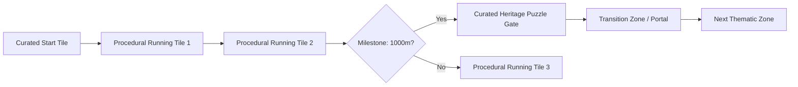

# Level Design: *Leela: Chronicles of Bharat*

This document describes how environments are structured, how the hybrid procedural-curated track system functions, and outlines specific level layouts.

---

## 1. Track Generation System

*Leela: Chronicles of Bharat* utilizes a **Hybrid Modular Level Generation** system. Rather than generating entirely random tracks or relying on fixed, static levels, the game combines procedural stitching with curated heritage segments.

### Key Components:
1. **Modular Track Prefabs (Tiles):** Standard 50-meter track blocks (straight, left-turn, right-turn, incline, decline). Each tile contains pre-defined lane paths, wall-running surfaces, and spawn points for obstacles/collectibles.
2. **Dynamic Stitching Engine:** As the player runs, the level manager randomly selects compatible tiles based on the current environment theme (e.g., Vrindavan Forest) and the player's current speed/difficulty level.
3. **Heritage Anchors (Curated Segments):** Fixed, historically accurate segments that spawn at set distances (every 1000 meters in endless mode, or at designated milestones in Story Mode). These anchors contain specific puzzles (e.g., the *Kesi Ghat Steps* or *Sudarshan Gate* challenges).
4. **Transition Portals:** Gates that load the next thematic environment using screen-space distortion shaders, avoiding loading screens during gameplay.

---

## 2. Level Design Specifications by Zone

### A. Mathura: The Prison Break (Intro / High Tension)
* **Visual Atmosphere:** Dark stone corridors, lit by flickering iron torches, iron gates, and heavy iron chains. In the background, rain storms lash against barred windows.
* **Pacing Curve:** Starts slow (tutorial phase) and quickly ramps up. Focuses on reaction speed.
* **Zone-Specific Obstacles:**
  * *Rolling Barrels:* Rolling metal casks containing guards' water supplies. Players must jump or lane-shift.
  * *Collapsing Arches:* Ancient stone lintels that crumble when the player gets close. Requires a fast slide.
  * *Iron Gates:* Swinging grid gates. Players must hit side buttons (lane-swiping) to trigger doors or slide underneath them.
* **Pacing Chart:**
  * *0m - 300m:* Simple tutorial tiles. Lane-shifting, jumping, sliding.
  * *300m - 700m:* Ramping speed. Introduction of rolling barrels and wall running.
  * *700m - 1000m:* High-speed run culminating in Vasudeva carrying baby Krishna across the stormy Yamuna (horizontal scrolling segment).

### B. Vrindavan: Sacred Groves (Nature / Traversal)
* **Visual Atmosphere:** Vibrant green canopies, blooming yellow Kadamba trees, colorful peacocks flying across lanes, and the shining waters of the Yamuna running alongside.
* **Pacing Curve:** Medium speed. Focuses on vertical traversal and navigation.
* **Zone-Specific Obstacles:**
  * *Thick Brambles:* Low-hanging thorny vines. Requires sliding.
  * *River Crevices:* Gaps in the track where the forest floor has washed away. Requires swing traversal using hanging vines.
  * *Kaliya Serpent Venom:* Geysers of purple venom shooting up from the riverbank, blocking lanes. Requires lane-switching or activation of a Sudarshana Shield.
* **Pacing Chart:**
  * *0m - 400m:* Forest path, introducing swing traversal and vine obstacles.
  * *400m - 800m:* Forest splits into the "Rasa Leela" rhythm path. Track turns into musical strings.
  * *800m - 1000m:* Culmination at Kesi Ghat. Player faces the Flute Melody Puzzle to pacify the wild forest animals.

### C. Dwarka: The Sunken City (Time Warp / Sci-Fi Magic)
* **Visual Atmosphere:** Shimmers with golden light. High, white marble pillars, massive copper bridges. When warped, the environment transitions to an underwater city with bioluminescent flora and swimming turtles.
* **Pacing Curve:** Fast. Focuses on quick lane choices and puzzle-matching.
* **Zone-Specific Obstacles:**
  * *Chariot Tracks:* High-speed ancient chariots coming down lanes (like the trains in Subway Surfers).
  * *Water Geysers (Underwater):* Upward currents that lift the player to a high lane.
  * *Coral Barriers:* Overgrown corals blocking lower lanes. Requires sliding or jumping.
* **Pacing Chart:**
  * *0m - 500m:* Running on the bridges of Golden Dwarka. High-speed chariot dodging.
  * *500m:* Time portal trigger. Seamless warp into Sunken Dwarka.
  * *500m - 1000m:* Underwater glide segment. Collecting artifacts while avoiding giant octopuses and coral walls.

---

## 3. Difficulty Tuning & Scaling
*Leela* uses a **Dynamic Difficulty Adjustment (DDA)** algorithm.

* **Speed Scaling:**
  $$\text{Speed} = \text{Base Speed} + (\text{Distance} \times 0.05) - (\text{Puzzles Failed} \times 0.2)$$
* **Obstacle Density:** As distance increases, the gap between obstacles shrinks from 2.5 seconds (easy) to 0.8 seconds (hardcore).
* **Puzzle Frequency:** Puzzles spawn closer together if the player is maintaining a high score multiplier, providing high-risk, high-reward scenarios for experienced players.
