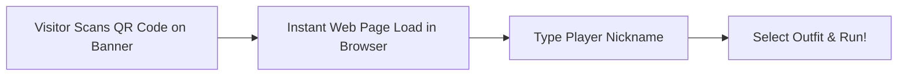

# Event Engagement & Distribution Strategy: *Leela: Chronicles of Bharat*

As a non-commercial, educational game designed specifically for cultural exhibitions and events, *Leela: Chronicles of Bharat* is entirely free, containing **zero advertisements, zero in-app purchases, and zero paywalls**. All design efforts focus on event onboarding, engagement, and sharing.

---

## 1. Zero-Friction Onboarding Setup

To maximize participation at live venues, we eliminate all registration screens and download barriers:

1. **QR Code Entry Points:** Large banners, posters, and pamphlets at the event venue feature custom QR codes linking to the game's WebGL URL.
2. **Visitor Login:** Players enter a simple, fun nickname (no email, phone, or passwords required) to start playing immediately.
3. **Optimized Size:** The first track load takes under 3 seconds on standard cellular connections due to Draco mesh compression and on-demand assets.

---

## 2. Event Engagement Mechanics

To drive excitement and participation, the game includes:

### A. Live Venue Projection Leaderboard
* **How it works:** A projector or large LED screen at the center of the event hall displays the real-time game leaderboard.
* **WebSocket Streams:** As players finish runs on their mobile devices, their scores are instantly transmitted via Socket.io to the server and appear on the main venue screen.
* **Top Runner Alerts:** When a player breaks the day's high score, the main display triggers a celebratory animation ("New High Score by [Nickname]!"), creating excitement in the event hall.

### B. Dedicated Physical Kiosk Stations
* **Hardware:** 2 to 4 desktop PC kiosks set up with large monitors and arcade-style joysticks or keyboards (WASD controls).
* **Purpose:** For visitors who do not have smartphones or prefer an immersive arcade experience. The kiosks run the exact same WebGL build in browser kiosk mode.

---

## 3. Educational Rewards & Progression
* **Unlockable Lore Scrolls:** Players collect *Gyan Patras* (Knowledge Fragments) during their runs. Collecting them unlocks beautiful illustrations and voiceovers explaining the historical significance of Vrindavan, Dwarka, or Mathura.
* **Participant Badges:** Upon completing a run or solving all puzzle gates, the browser displays a custom digital "Heritage Badge" featuring their nickname. Players can easily take a screenshot to share with family or friends on social media.
