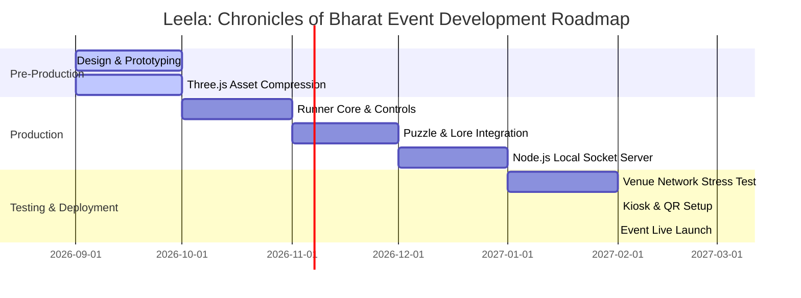

# Roadmap: *Leela: Chronicles of Bharat*

This document details the development lifecycle, testing phases, and live execution plan leading up to the cultural event.

---

## 1. Development Phases & Milestones

The project is structured into three rapid phases targeting the designated event date.

### Pre-Production (Months 1–2)
* **Milestone 1 (Design Locked):** GDD and Technical Architecture configured for Three.js.
* **Milestone 2 (Assets Prepped):** Low-poly 3D models compressed using Draco (.glb format).
* **Deliverables:** Game Vision Doc, asset lists, basic Three.js scene loader.

### Core Production (Months 3–5)
* **Milestone 3 (First Playable):** Lane-shifting, slide-turns, and keyboard/swipe inputs running smoothly at 60 FPS on mobile web browsers.
* **Milestone 4 (Puzzles Active):** Sudarshan Gates and Flute Melody puzzles fully functional, halting the runner and displaying matching overlays.
* **Deliverables:** Single-player WebGL prototype, local puzzle UI scripts.

### Backend & Event Setup (Months 6–7)
* **Milestone 5 (Local Server Deploy):** Node.js Socket.io server active. Scores successfully stream to a central database and render on a live leaderboard display page.
* **Milestone 6 (Kiosk Integration):** Standalone PC build mapped to physical keys; kiosk display pages tested.
* **Deliverables:** Local node.js server package, projected leaderboard page, and static WebGL build.

### Live Event Execution (Month 8)
* **Pre-Event (2 Weeks Out):** Stress test the local router at the venue with 100+ concurrent simulated browser runs. Set up QR banner prints.
* **Event Day:** Deploy the live scoreboard screen, launch kiosk stations, and place QR signs throughout the exhibition.
