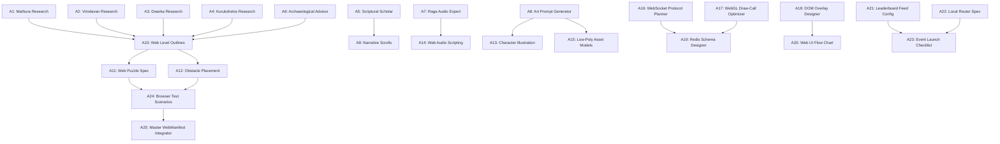

# Team Structure & Agent Orchestration: *Leela: Chronicles of Bharat*

This document defines the simplified, event-focused human team composition and outlines the 25-agent automated pre-production pipeline configured for a Three.js-first WebGL project.

---

## 1. Human Team Roles & Responsibilities

For our non-commercial event edition, the development team is streamlined to maximize agility and focus on local installation parameters.

1. **Lead Game Designer & Writer:** Designs the runner paths, puzzle gates, and writes the dialogue/narration for the educational Story Scrolls.
2. **Lead Three.js & WebGL Developer:** Programs the player movement, WebGL scene renderer, obstacle pools, and responsive swipe controls.
3. **3D/2D Artist & Animator:** Creates low-poly models, applies Draco compression, and illustrates the Story Scroll screens.
4. **Node.js/Socket.io Developer (Part-time):** Programs the WebSocket server, aggregates live high scores in Redis, and builds the projected leaderboard page.
5. **Event Setup Coordinator:** Handles the physical kiosk setups, local Wi-Fi router configurations at the venue, and prints QR banners.

---

## 2. The 25-Agent Pre-Production Workflow

To automate research, asset preparation, and code layout, we utilize 25 parallel agents coordinated specifically for HTML5/Three.js web development.

### Agent Directory: Three.js Configuration

| Agent ID | Agent Role | Inputs | Outputs | Deliverables |
| :--- | :--- | :--- | :--- | :--- |
| **Agent 1** | Mathura Researcher | Historical descriptions. | Landmark points. | Mathura Site Profile. |
| **Agent 2** | Vrindavan Researcher | Forest foliage references. | Flora checklist. | Vrindavan Plant and Tree list. |
| **Agent 3** | Dwarka Researcher | Underwater maps. | Sea arch designs. | Dwarka Ruins Guide. |
| **Agent 4** | Kurukshetra Researcher | Chariot references. | Chariot models. | Chariot Layout. |
| **Agent 5** | Scriptural Scholar | Sacred writings. | Key morals and quotes. | Scripture Database. |
| **Agent 6** | Archeological Advisor | Temple spires. | Sandstone column types. | Column Model Guide. |
| **Agent 7** | Raga Audio Expert | Classical Indian scales. | Web-playable Sargam notes. | Audio Scale Sheet. |
| **Agent 8** | Art Prompt Generator | Visual research. | AI image scripts. | Midjourney Prompt Guide. |
| **Agent 9** | Narrative Scrolls Writer | Story summaries from A5. | Text scroll pages. | Story Voiceover Script. |
| **Agent 10** | Web Level Outlines | Sites from A1–A4, A6. | Curated tile spawn arrays. | Tile Sequence Matrix. |
| **Agent 11** | Web Puzzle Specifier | Melody sheets (A7). | HTML overlay puzzle wireframes. | Puzzle UI Layout Sheet. |
| **Agent 12** | Obstacle Placement | Level tiles from A10. | Z-axis obstacle coords. | Spawn Database. |
| **Agent 13** | Character Illustration | Prompts from A8. | Character cards (PNG). | Avatar Texture Atlas. |
| **Agent 14** | Web Audio Scripting | Audio scales from A7. | Web Audio API loader. | Audio Controller Class. |
| **Agent 15** | Low-Poly Asset Models | Prompts from A8. | Draco-compressed GLB meshes. | GLB Mesh Library. |
| **Agent 16** | WebSocket Planner | Game score loops. | JSON event sync protocol. | WebSocket Event Schema. |
| **Agent 17** | WebGL Draw-Call Optimizer | Three.js specs. | Draw-call thresholds. | Rendering Budgets. |
| **Agent 18** | DOM Overlay Designer | Wireframes. | CSS3 responsive rules. | UI Overlay CSS/HTML templates. |
| **Agent 19** | Redis Schema Designer | Sync protocol (A16). | Redis key-value structures. | Redis Schema Migration Script. |
| **Agent 20** | Web UI Flow Chart | UI templates from A18. | Single-page App (SPA) routing. | Single-page Flow Diagram. |
| **Agent 21** | Leaderboard Feed Config | Dialogue & stories. | Broadcast message formats. | Score Screen JSON specification. |
| **Agent 22** | Local Router Specifier | Venue blueprints. | IP allocation, router settings. | Venue Network Guide. |
| **Agent 23** | Event Launch Checklist | Feed specs & Network guide. | Setup steps for Kiosks. | Venue Setup Guide. |
| **Agent 24** | Browser Test Scenarios | Puzzle specs & spawn tables. | Mobile Safari/Chrome audit rules. | Web QA Matrix. |
| **Agent 25** | Master WebManifest Integrator| All outputs. | Final Web Manifest structure. | Master Deploy Script. |
