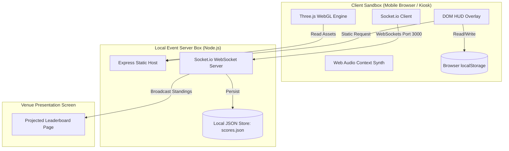

# System Architecture: *Leela: Chronicles of Bharat*

This document provides a comprehensive view of the system architecture, component dependencies, data flow, and security/reliability risk zones.

---

## 1. System Overview

*Leela: Chronicles of Bharat* is a client-server WebGL endless runner and educational puzzle game. It is designed to run in mobile and desktop browsers with zero installation and latency constraints during live cultural events.

---

## 2. Component Mapping

1. **Static Host (`server.js`):** Node.js Express server configured to serve client files.
2. **WebSocket Server (`server.js`):** Socket.io connection manager that coordinates score submissions, sorts standing tables, and writes data to disk.
3. **HTML5 Viewport (`public/index.html`):** The structural host containing the WebGL container canvas and DOM HUD layers.
4. **Game Controller (`public/src/main.js`):** The core orchestrator managing state transitions (`START`, `INTRO`, `PLAYING`, `PUZZLE`, `GAMEOVER`), timing clocks, scoring multipliers, and triggers.
5. **Locomotion & Physics (`public/src/player.js`):** Binds gesture/keyboard controls to lane-switching, slide scaling, and jumping velocities. Builds the 3D player chibi avatar.
6. **Track Spawner (`public/src/track.js`):** Seamless endless scrolling track segments with dynamic theme swapping (Mathura and Gokul).
7. **Entity Pooler (`public/src/obstacles.js`):** Spawns low stones, high floral arches, Sanskrit arches, Makhan Pots (coins), and powerups (Chakra, Feather).
8. **Puzzle Evaluator (`public/src/puzzles.js`):** Auditory sequence memory puzzle and Sudarshan gate targets prompt.
9. **Juice Engine (`public/src/effects.js`):** 3D particle bursts and Web Audio oscillator beep sound effects.

---

## 3. Data Flow Diagrams

### High Score Submission & Broadcast
1. Player crashes into an obstacle.
2. `main.js` triggers `gameOver()` and calls `pushScoreToEventLeaderboard()`.
3. The client packages name, score, and butter pots count and emits `submit_score` via Socket.io.
4. `server.js` receives the payload, executes duration-based security checks, updates the standings, writes to `scores.json`, and broadcasts `update_leaderboard` containing the top 10 standings.
5. The projected `scoreboard.html` screen client receives the socket broadcast and updates the screen grid and scrolling marquee.

---

## 4. Architectural Risk Areas

| Risk Profile | Severity | Target Mitigation |
| :--- | :--- | :--- |
| **Static File Exposure** | High | Restructure directory, locking private server files (`server.js`, `scores.json`, `package.json`) away from public folders. Only serve `public/` directory. |
| **Score Injection (Cheating)** | High | Implement duration validation algorithms on the server to detect speed hacking or console event triggers. |
| **Stale World Matrices** | Medium | Force coordinate world-matrix sync on player and obstacle groups before checking bounding intersections to remove frame lag. |
| **Resource Allocation Leaks** | Medium | Manage audio nodes and particle mesh lifecycles. Ensure oscillators disconnect and shared geometries are not destroyed prematurely. |
